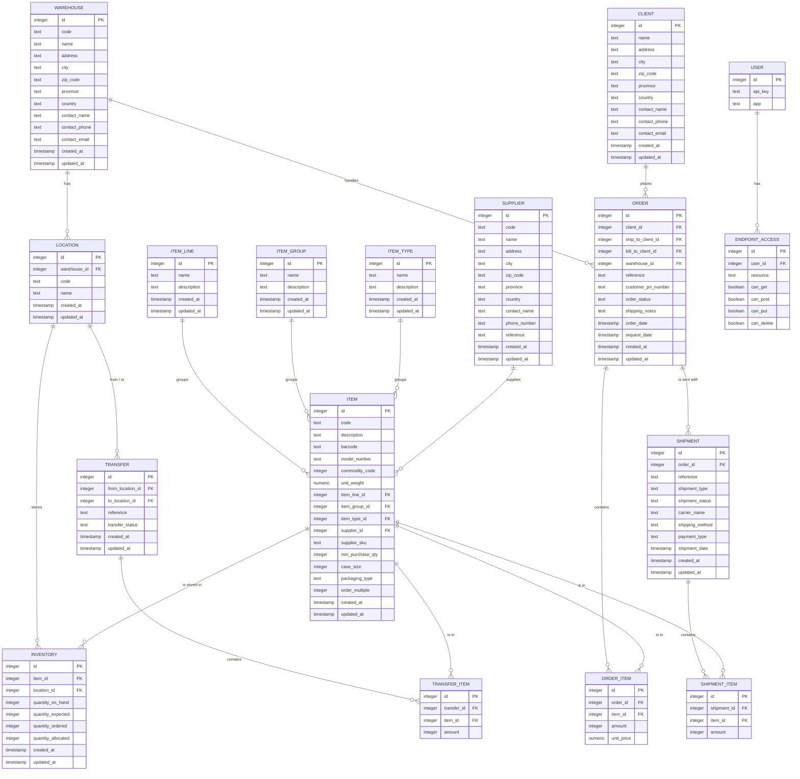

# CargoHub data model

This data model belongs to chapter 3.2 of the research report. It is based on the JSON files in `v1/data/`. Every JSON file becomes one table in PostgreSQL. The field names stay the same as in v1, so the API stays compatible.

## ERD

## Tables

| Table | JSON file in v1 | Description |
|---|---|---|
| WAREHOUSE | warehouse.json | A distribution centre with address and contact details |
| LOCATION | location.json | A place (bin) in a warehouse |
| ITEM | item.json | A product |
| ITEM_LINE | item_line.json | The assortment line of an item |
| ITEM_GROUP | item_group.json | The group of an item, for example Vers |
| ITEM_TYPE | item_type.json | The kind of packaging of an item, for example Single |
| SUPPLIER | supplier.json | A company that supplies items |
| INVENTORY | inventory.json | The stock of one item on one location |
| CLIENT | client.json | A store that places orders |
| ORDER | order.json | An order from a client |
| ORDER_ITEM | order_item.json | One line in an order: which item and how many |
| SHIPMENT | shipment.json | A shipment that belongs to an order |
| SHIPMENT_ITEM | shipment_item.json | One line in a shipment: which item and how many |
| TRANSFER | transfer.json | Moving items from one location to another |
| TRANSFER_ITEM | transfer_item.json | One line in a transfer: which item and how many |
| USER | user.json | An application with its own API key |
| ENDPOINT_ACCESS | user.json | What a user is allowed to do on one resource |

## Relations and keys

Every table has `id` as primary key. The relations run through the following foreign keys.

| Foreign key | Points to | Meaning |
|---|---|---|
| LOCATION.warehouse_id | WAREHOUSE.id | A location is in one warehouse |
| ITEM.item_line_id | ITEM_LINE.id | An item belongs to one item line |
| ITEM.item_group_id | ITEM_GROUP.id | An item belongs to one item group |
| ITEM.item_type_id | ITEM_TYPE.id | An item has one item type |
| ITEM.supplier_id | SUPPLIER.id | An item comes from one supplier |
| INVENTORY.item_id | ITEM.id | The stock is of one item |
| INVENTORY.location_id | LOCATION.id | The stock is on one location |
| ORDER.client_id | CLIENT.id | The client that places the order |
| ORDER.ship_to_client_id | CLIENT.id | The client the order is shipped to |
| ORDER.bill_to_client_id | CLIENT.id | The client that gets the bill |
| ORDER.warehouse_id | WAREHOUSE.id | The warehouse that handles the order |
| ORDER_ITEM.order_id | ORDER.id | The line belongs to one order |
| ORDER_ITEM.item_id | ITEM.id | The item of the line |
| SHIPMENT.order_id | ORDER.id | The shipment belongs to one order |
| SHIPMENT_ITEM.shipment_id | SHIPMENT.id | The line belongs to one shipment |
| SHIPMENT_ITEM.item_id | ITEM.id | The item of the line |
| TRANSFER.from_location_id | LOCATION.id | The location the items come from |
| TRANSFER.to_location_id | LOCATION.id | The location the items go to |
| TRANSFER_ITEM.transfer_id | TRANSFER.id | The line belongs to one transfer |
| TRANSFER_ITEM.item_id | ITEM.id | The item of the line |
| ENDPOINT_ACCESS.user_id | USER.id | The access rights belong to one user |

The tables ORDER_ITEM, SHIPMENT_ITEM, TRANSFER_ITEM and INVENTORY solve a many-to-many relation with ITEM.

In INVENTORY the combination of `item_id` and `location_id` can only exist once. The same goes for `user_id` and `resource` in ENDPOINT_ACCESS.

## Differences with the first sketch

The first sketch of the team only had the keys. This model adds the following.

- The CLIENT table was missing. ORDER points to it three times.
- SUPPLIER had no relation. ITEM has a `supplier_id`.
- USER only had an id. The access rights per resource are now in ENDPOINT_ACCESS.
- All fields from the JSON files are included.

## Findings about the v1 data model

- The JSON files do not check foreign keys. You can create an order with a `client_id` that does not exist.
- In the current data all references are correct. This was checked for all foreign keys in the table above.
- `inventory.json` has no `id` of its own. V1 uses `item_id` together with `location_id` as the key.
- A shipment has one `order_id`, but the endpoint `/shipments/{id}/orders` works with a list of orders. V1 only keeps the first order of the list.
- In `user.json` the API keys are stored as readable text.
- The access rights in `user.json` are a nested object. That does not fit in a table, so it is split into its own table.
- The status fields are free text. These values are in the data: order `Pending` and `Shipped`, shipment `Scheduled`, `Transit` and `Delivered`, transfer `Scheduled` and `Processed`.

## Choices

- The table and field names are the same as in v1, so the data is easy to move over.
- INVENTORY gets its own `id`, like the other tables.
- The API key is stored as a hash and not as readable text.
- The foreign keys are checked by the database.
